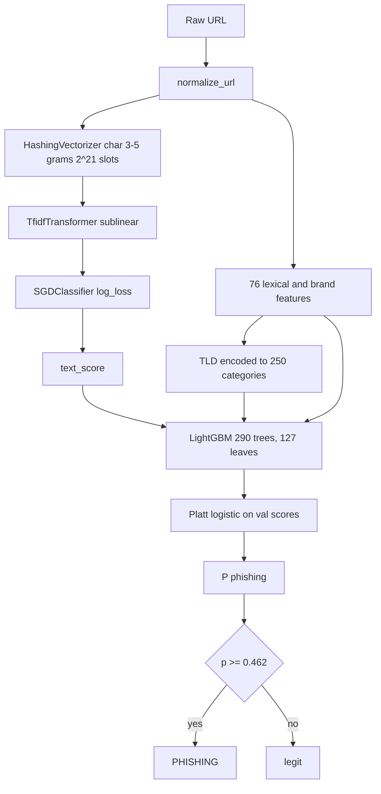

# Architecture

This is a **URL-only** phishing detector: the input is a string, the output is P(phishing). Nothing is fetched.

## Why a stack

On the same 2.4M-row, domain-grouped split:

| Stage | ROC AUC | What it sees |
|---|---|---|
| Char n-grams only | 0.946 | Substrings: `-secure-login`, odd character runs, kit paths |
| Lexical + brand features only | 0.943 | Structure: TLD, depth, brand in subdomain, typos, IP tricks |
| **Stacked** | **0.970** | Both, with out-of-fold text scores so the tree cannot memorize train-set n-gram scores |

The gap between “either half” and the stack is larger than the gap between LightGBM, XGBoost, and HistGradientBoosting as the second stage (all ~0.968–0.971). LightGBM is the production second stage because it matches the others, trains in ~2 minutes, and does not need a custom scikit-learn GBM path.

A URLNet-style char CNN reaches 0.961 on full data (34 min train). DistilBERT fine-tuned on 200k URLs reaches 0.970 — same as the stack trained on 12× more rows — but scores at 496 URLs/s and is 268 MB. The stack is ~1.8k URLs/s and 13 MB.

## Pipeline



### 1. Normalization

`normalize_url` strips the scheme, a leading `www.`, lowercases the host, and drops a trailing slash. Datasets disagree on whether they store `https://`; keeping the scheme would let the model learn *source* instead of *URL*.

Registered domain uses `tldextract` with the bundled public-suffix list (offline).

### 2. Text model (~2.1M weights)

```
HashingVectorizer(analyzer="char", ngram_range=(3, 5), n_features=2**21)
  → TfidfTransformer(sublinear_tf=True)
  → SGDClassifier(loss="log_loss", alpha=1e-6)
```

Hashing avoids a stored vocabulary. Almost every hash slot is used after 2.4M URLs.

For stacking, training-set text scores are **out-of-fold** (`GroupKFold` 3, grouped by registered domain). Val/test/live/external scores come from a text model fit on all of train.

### 3. Lexical and brand features (~76)

Computed only from the normalized string. Families:

- Lengths, counts, entropy, token stats
- Host tricks: userinfo, port, IPv4 / octal / dword / hex IP, punycode, mixed script, homoglyphs, emoji, encoded URL in the path, open-redirect query keys
- Hosting: shortener list, free-host labels (`pages.dev`, `ngrok`, …)
- TLD: suspicious set, “looks like `.com`”, ccTLD
- **Brand impersonation** (vocabulary = ~391 curated names + top Tranco SLD labels, stored in the model bundle):
  - `domain_is_brand` (real paypal.com is *not* a lure)
  - brand in subdomain / path, brand token or substring in a non-brand domain
  - typo via delete-neighbourhood + leet, and min edit-distance to a curated brand

The brand list is built in `build_dataset` and must be the same at train and predict (`set_brands` on the bundle).

### 4. LightGBM

`num_leaves=127`, `n_estimators=1500` with early stopping (50 rounds), TLD as a pandas category. The evaluation model stopped at **290** trees. Sample columns include `text_score`.

### 5. Calibration and threshold

A logistic (Platt) map is fit on **validation** raw scores. The threshold is the val F1 maximum on the calibrated scores (0.462). Ranking metrics are identical with and without Platt; log loss was slightly better uncalibrated (0.223 vs 0.242). The calibrator is still in the bundle so `predict_proba` is a probability.

On low-prevalence traffic, do not use 0.462. Use a higher cut or `recall_at_1pct_fpr` from `models/metrics.json`.

### 6. Refit

Metrics above are from the grouped hold-out. The **shipped** file is then refit on train+val+test+`refit_only` with the same number of boosting rounds, so a domain that the split placed entirely in test is still learned. The threshold is not retuned after refit.

## Training protocol

1. Extract features (cached under `data/processed/bench_cache/` for benchmarks only).
2. OOF text scores on train; fit text model on all train.
3. Baseline LightGBM on features without `text_score`.
4. Stacked LightGBM on features + OOF `text_score`.
5. Platt + best-F1 threshold on val.
6. Score test, live, PhreshPhish, JPxxx, DeepURLBench; write `models/scores.parquet`.
7. Refit text + trees on all labelled rows except live/external.

`python -m phishdetect.eval_external` scores an extra parquet against the saved detector without retraining.

## Leakage controls

- Domain-grouped splits: no shared registered domain across train/val/test.
- Live feeds stripped from every other source before splitting.
- External sets drop URLs already in the pool; `seen_domain` marks whether the *domain* was in train.
- OOF text scores for the stacker.
- Normalization so scheme / `www.` cannot identify the originating dataset.
- Low-trust sources (`kaggle_malicious_urls`, `hf_kmack`) lose label conflicts.

## What we did not put in production

| Idea | Why not |
|---|---|
| HTML / screenshot / TLS | Breaks “score before visit”; high latency |
| DNS / RDAP age | Same; DeepURLBench showed DNS helps URLNet but is online |
| DistilBERT as the scorer | Matches accuracy on 200k rows; 30× slower, 20× larger |
| Frozen URLBERT-tiny | Segfaults under this PyTorch / Python 3.14 build |
| DeepURLBench in *train* | CC-BY-NC, 40M rows, mixes malware; kept as hold-out |

XGBoost as the second stage is +0.003 AUC vs LightGBM on the latest split. A drop-in if you want that bump; not worth a new dependency story by itself.
